# Laporan Praktikum Pemrograman Web — Modul 5

**Topik:** JavaScript Dasar dan Manipulasi HTML  
**Nama:** Rendi Ichtiar Prasetyo  
**NIM:** 312510087  
**Kelas:** I251A

## Tujuan

Praktikum ini mengenalkan JavaScript di halaman web: menampilkan pesan, menggunakan variabel dan operator, membuat percabangan dan function, serta memilih dan mengubah elemen HTML. Latihan juga mencakup form, validasi input, dan event pada checkbox.

## Struktur berkas

```text
lab5_javascript/
├── index.html       # Halaman latihan dan form
├── script.js        # Kode JavaScript dan interaksi DOM
├── README.md        # Laporan dan dokumentasi
└── screenshots/     # Gambar dokumentasi dari laporan praktikum
```

## Cara menjalankan

1. Pastikan `index.html` dan `script.js` berada di folder yang sama.
2. Buka `index.html` dengan browser modern. Jika memakai Visual Studio Code, halaman juga dapat dijalankan dengan ekstensi Live Server.
3. Saat halaman dibuka, ikuti prompt latihan sebelumnya untuk nama, nilai, dan pilihan switch. Setelah itu, bagian latihan lain dapat dicoba melalui form dan tombol pada halaman.

## Hasil praktikum

### Latihan 1 — Menampilkan output

JavaScript mengubah teks pada halaman menjadi “Hello World” dan menulis pesan ke Console.

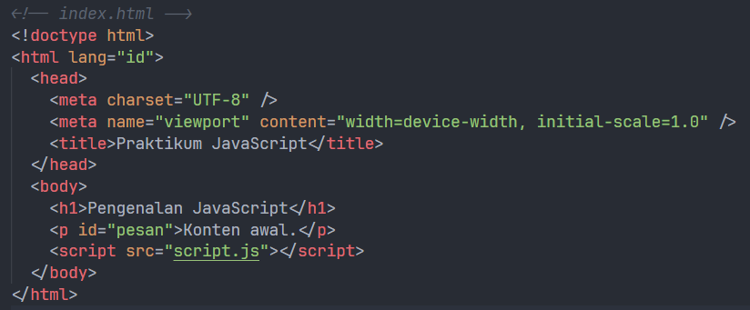

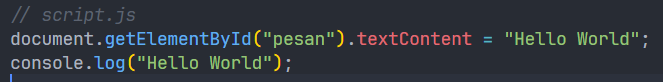

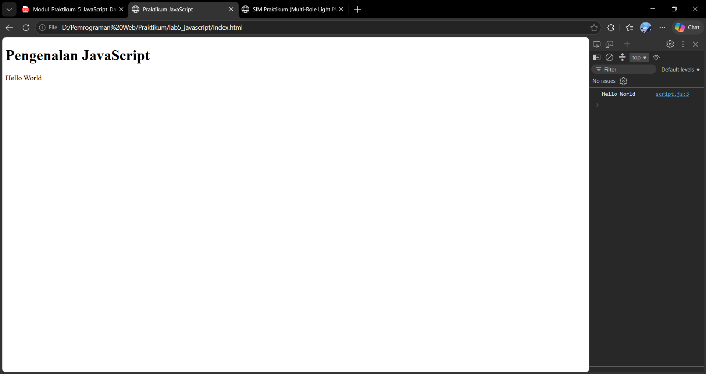

### Latihan 2 — Alert dan prompt

Program meminta nama melalui `prompt()`. Jika nama diisi, halaman menyapa pengguna; jika kosong atau dibatalkan, program memberi pesan bahwa nama belum diisi.

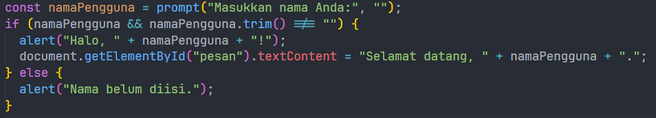

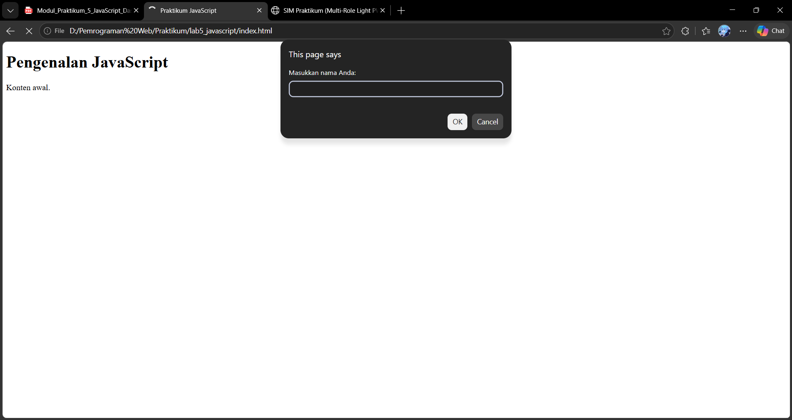

### Latihan 3 — Function dan operasi aritmetika

Function `operasiDasar(a, b)` menampilkan hasil penjumlahan, pengurangan, perkalian, pembagian, dan modulus di Console. Contoh awal menggunakan nilai `9` dan `4`.

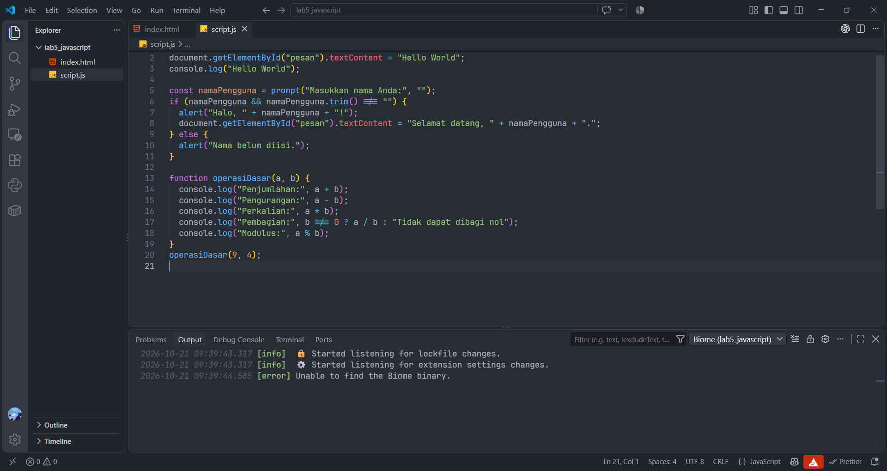

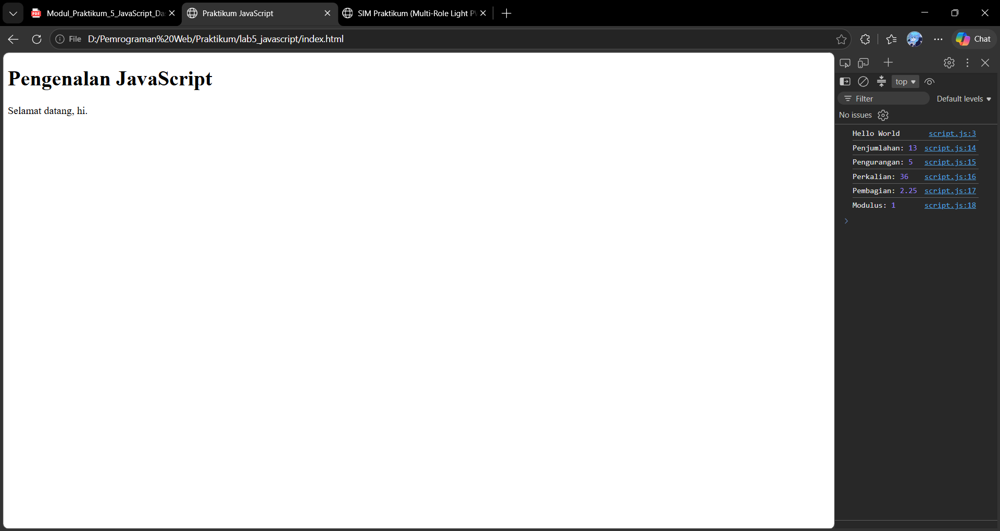

### Latihan 4 — Seleksi kondisi if-else

Program meminta nilai 0–100. Nilai minimal 60 dinyatakan lulus; masukan kosong atau di luar rentang ditolak.

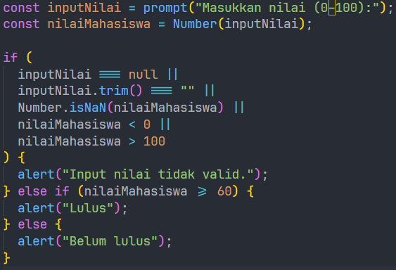

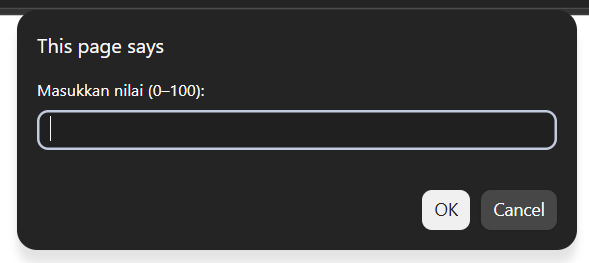

### Latihan 5 — Seleksi kondisi switch

Program meminta pilihan angka 1–5 dan menampilkan nama bilangan yang sesuai.

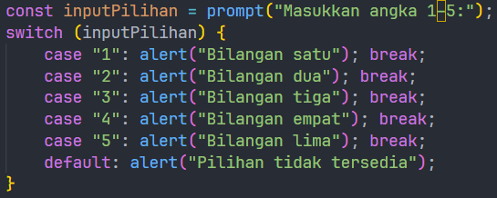

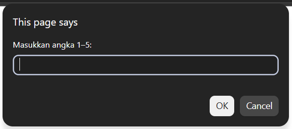

### Latihan 6 — Form bilangan genap atau ganjil

Pengguna memasukkan bilangan bulat melalui form. Halaman menampilkan hasil pemeriksaan genap atau ganjil.

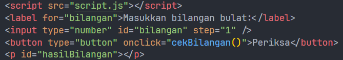

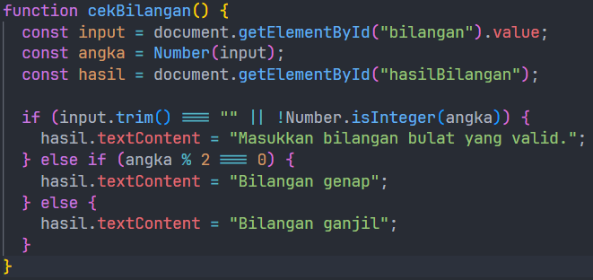

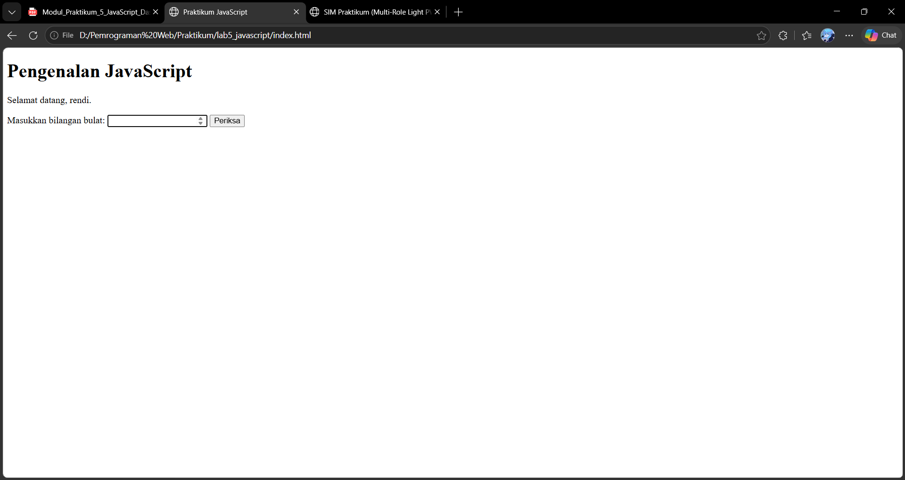

### Latihan 7 — Mengubah warna halaman

Tiga tombol memanggil satu function dengan parameter warna untuk mengubah latar halaman.

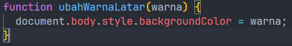

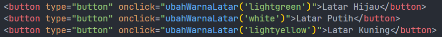

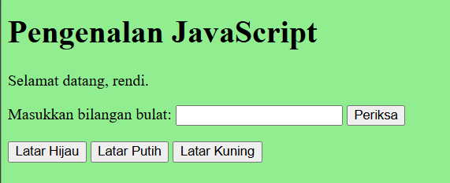

### Latihan 8 — DOM dan checkbox menu makanan

Checkbox menu menggunakan event `change`. Total harga diperbarui ketika pilihan menu dicentang atau dilepas.

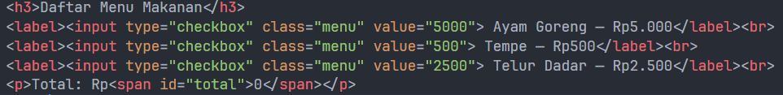

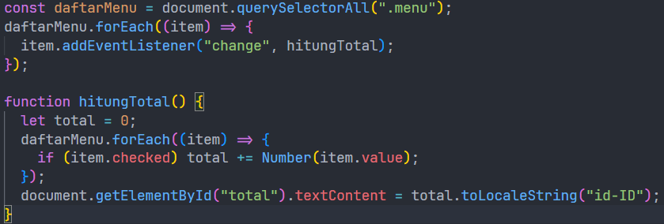

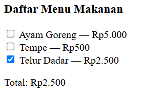

## F. Mini Project — Kalkulator Nilai Mahasiswa

Form menerima nilai tugas, UTS, dan UAS, masing-masing pada rentang 0–100. Nilai akhir dihitung dengan rumus:

```text
Nilai akhir = tugas × 0,30 + UTS × 0,30 + UAS × 0,40
```

Predikat ditentukan dari nilai akhir: A untuk nilai minimal 85, B minimal 75, C minimal 60, D minimal 50, dan E untuk nilai di bawah 50. Status kelulusan adalah “Lulus” jika nilai akhir minimal 60. Form menampilkan pesan jika kolom kosong atau nilai berada di luar rentang.

Contoh skenario untuk dicoba pada form:

| Tugas | UTS | UAS | Nilai akhir | Predikat | Status |
|---:|---:|---:|---:|:---:|---|
| 85 | 78 | 88 | 84,10 | B | Lulus |
| 70 | 70 | 70 | 70,00 | C | Lulus |
| 40 | 40 | 40 | 40,00 | E | Belum lulus |

## G. Eksperimen Mandiri

Eksperimen berikut tersedia pada halaman:

1. Meminta dua nilai dengan `prompt()`, mengonversinya menjadi number, lalu menghitung operasi aritmetika.
7. Menggunakan perulangan untuk menampilkan tabel perkalian 7 dari 1 sampai 10.
8. Menggunakan function `cekGenap(angka)` yang mengembalikan `true` untuk bilangan genap dan `false` untuk bilangan ganjil.
9. Memastikan kolom form kalkulator nilai wajib diisi.
10. Menambah pilihan menu Sambal seharga Rp1.000 dan Es Teh seharga Rp3.000 pada daftar checkbox.
11. Menggunakan tombol untuk menyembunyikan atau menampilkan keterangan pada halaman.

Gambar pada README ini berasal dari laporan DOCX yang diberikan dan mencakup latihan 1–8. Laporan tersebut belum memuat tangkapan layar untuk Mini Project dan Eksperimen Mandiri.
